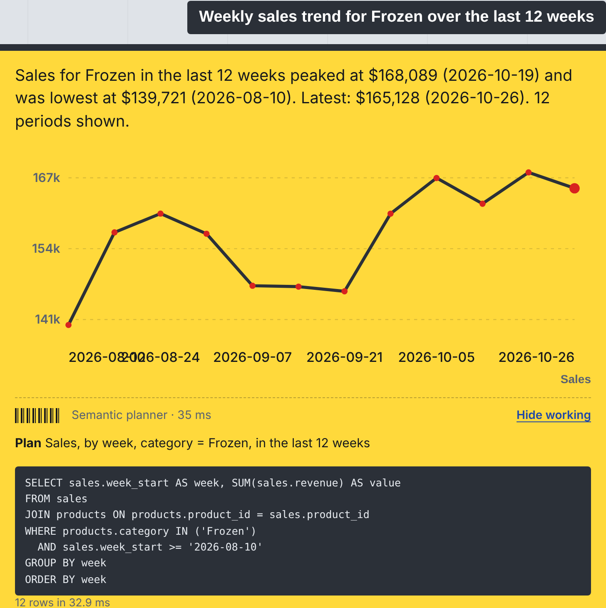
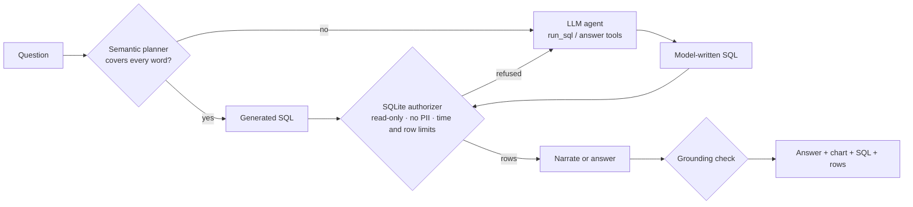
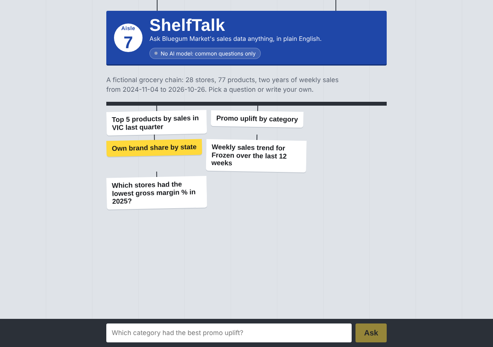
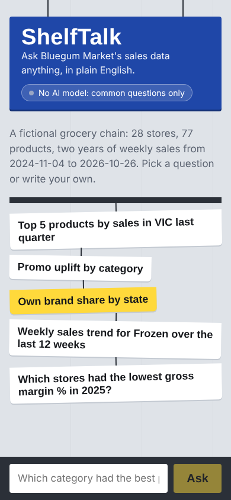

# ShelfTalk

Ask a grocery chain's sales data questions in plain English and get answers you can check.

**[Open the app](https://bunki-dev.github.io/shelftalk/)** · runs entirely in your browser · no sign-up, no server



ShelfTalk is a text-to-SQL assistant over a synthetic warehouse for **Bluegum Market**, a fictional chain with 28 stores, 77 products and two years of weekly sales (about 220,000 rows, plus promotions and a loyalty table with personal details that must never be exposed).

It's built the way I'd want a production analytics agent built:

- **Deterministic first.** A semantic-layer planner answers common questions (metric × dimensions × filters × time) with no model at all, in about 20 ms, with SQL that's correct by construction.
- **LLM for the long tail.** Anything the planner can't cover fully goes to a tool-using agent (Claude or Azure AI Foundry) that writes SQL, runs it, and answers.
- **Guarded at the engine, not the prompt.** Every query, from either path, runs through a SQLite authorizer on a read-only connection. Personal-data columns, writes, schema tables, long-running queries and huge results are refused by the database itself.
- **Every number checked.** A grounding check flags any number in an LLM answer that doesn't appear in a query result.
- **Measured.** Execution-accuracy evals against gold SQL run in CI.

## How it works



| Piece | What it does |
|---|---|
| `generate.py` | Builds the synthetic warehouse with patterns worth finding: a store refit, two new stores, state differences in own-brand affinity, category promo sensitivity and seasonality. Deterministic seed. |
| `data/semantic.yml` | The semantic layer: tables, joins, metrics with formulas (revenue, units, gross margin, margin %, average price, promo share, own-brand share, promo uplift), dimensions, synonyms and personal-data columns. |
| `warehouse.py` | Opens the database read-only and installs an authorizer: only `SELECT` and reads of allowed tables or CTEs; personal-data columns and `sqlite_*` tables denied; one statement; 3-second budget; 500-row cap. |
| `planner.py` | Matches time, metric, filters, dimensions, ranking and trend from the question, and only answers if it accounted for every meaningful word. Otherwise it hands over to the agent. "Why" and "compare" questions always go to the agent. |
| `assistant.py` | Planner first, then the agent: at most 6 steps and 5 queries, 40 rows shown to the model, the last 3 exchanges kept for follow-ups. |
| `llm.py` | Small adapters for the Anthropic Messages API and Azure OpenAI chat completions over a plain HTTP POST, so the same code runs on a server and in the browser. |
| `grounding.py` | Extracts numbers from the answer ($, %, k, M) and checks each against the result sets, with a tolerance for rounding. |
| `mcp_server.py` | The same guarded warehouse as an MCP server: `describe_warehouse`, `run_sql`, `quick_answer`. |
| `browser.py` + `web/` | Runs the Python in a Web Worker with Pyodide. The page is React and TypeScript with hand-drawn SVG charts. |

## Evals

`evals/questions.yml` has 24 business questions with gold SQL and 5 safety cases. An answer is correct if its result rows match the gold rows (order too, for rankings; numbers within 0.5%).

| Mode | Coverage | Accuracy on answered | Safety | p50 latency |
|---|---|---|---|---|
| Semantic planner only (CI, no model) | 16/24 (67%) | **100%** | 5/5 | 22 ms |

The planner deliberately declines what it can't fully parse rather than guessing, which is why coverage is 67% and accuracy is 100%. With a model connected, the remaining questions go to the agent; run `LLM_PROVIDER=anthropic python evals/run_evals.py` to measure that path, including how many LLM answers are fully grounded.

Safety cases: asking for customer emails, a prompt injection that asks for personal data, a write attempt, and two out-of-scope questions (weather, a competitor's sales). None return personal data, none write, and the out-of-scope questions run no SQL.

## Run it

In the browser: **[bunki-dev.github.io/shelftalk](https://bunki-dev.github.io/shelftalk/)**. Common questions work immediately. For open-ended ones, add a Claude or Azure AI Foundry key in the model settings; it's stored only in your browser and sent only to that provider.

Locally:

```bash
pip install -e ".[dev,mcp]"
shelftalk "top 5 products by sales in VIC last quarter"       # planner, no key needed
LLM_PROVIDER=anthropic ANTHROPIC_API_KEY=... shelftalk "why did Box Hill dip in August 2025?"
pytest -q
python evals/run_evals.py --mode planner
python -m shelftalk.mcp_server                                  # MCP over stdio
```

The warehouse is generated on first use (about 17 MB, a few seconds).

## Screens

 

All data is synthetic. Bluegum Market is fictional.
